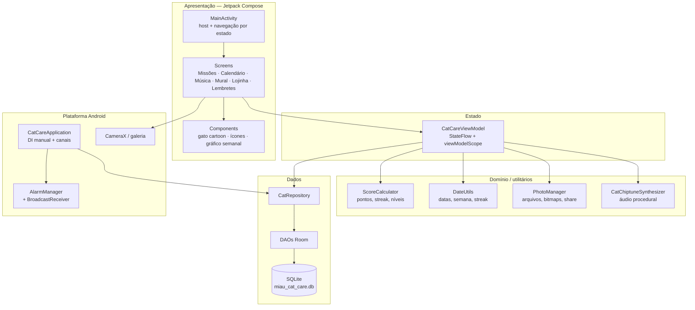
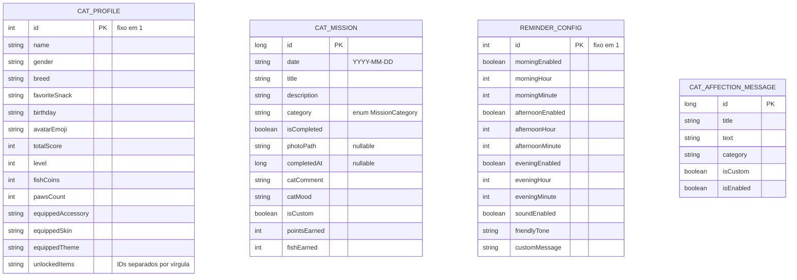

# 🐾 Cat Quest

Aplicativo Android nativo que transforma o cuidado diário com o gato em um jogo afetivo: **missões diárias comprovadas por foto**, pontos, peixinhos, sequência de dias (streak), lojinha de customização, retrospectiva mensal com trilha sonora e notificações carinhosas.

> Projeto acadêmico de Desenvolvimento Mobile, construído em **Kotlin + Jetpack Compose**, com persistência **local-first** e arquitetura **MVVM + Repository**.

<p>
  
  
  
  
</p>

---

## 📖 A ideia

Cat Quest
Quem convive com um gato sabe que os cuidados importantes são pequenos, recorrentes e fáceis de esquecer: trocar a água, servir o sachê, limpar a caixa de areia, brincar, escovar os pelos, dar carinho. O **Miau Missões** existe para:

1. **Lembrar** o tutor desses cuidados nos melhores horários do dia.
2. **Registrar** cada cuidado com uma foto, criando um álbum afetivo do dia a dia.
3. **Recompensar** a constância com pontos, níveis e moedas (peixinhos).
4. **Personalizar** o gatinho com pelagens, acessórios e temas.
5. **Revisitar** o mês em uma retrospectiva com música e estatísticas.
6. **Criar vínculo** com mensagens de carinho e incentivo escritas na voz do gato.

O tom do app é de **acolhimento e brincadeira**, não de cobrança: o gato "fala" com o tutor, comenta as fotos e comemora cada missão.

### Princípios do produto

| Princípio                  | Como aparece no app                                                                            |
| -------------------------- | ---------------------------------------------------------------------------------------------- |
| **Local-first / offline**  | Todo o estado vive em um banco Room no dispositivo; nenhuma conta ou servidor é necessária.    |
| **Baixa fricção**          | Missões padrão já vêm criadas para o dia; a prova é uma foto (câmera, galeria ou selo gerado). |
| **Privacidade**            | As fotos ficam no armazenamento interno do app (`filesDir/cat_photos`).                        |
| **Afeto antes de métrica** | Comentários do gato, emojis, paleta pastel e notificações em tom carinhoso.                    |
| **Progressão visível**     | Barra semanal, streak, nível do tutor, peixinhos e lojinha.                                    |

---

## ✨ Funcionalidades

### 1. Missões diárias (`Missões`)

- Seis missões padrão criadas automaticamente por data:
  - 💧 Água fresca
  - 🍽️ Alimentação & sachê
  - 🧹 Caixa de areia
  - 🎾 Brincadeira ativa
  - 🪮 Escovação & higiene
  - 💖 Carinho & ronrom
- Sétima categoria disponível em missões personalizadas: 🩺 Saúde & checkup.
- Criação de **missões customizadas** (título, descrição e categoria).
- Conclusão com **prova fotográfica**:
  - câmera interna construída com **CameraX** (troca de lente, flash, enquadramento);
  - câmera do sistema via `ActivityResultContracts.TakePicture`;
  - galeria via `PickVisualMedia`;
  - "selo mágico" gerado em bitmap (`PhotoManager.createSampleCutePhoto`) para testes/demonstração.
- Desfazer conclusão (devolve pontos e peixinhos) e excluir missão.
- Comentário e humor do gato sorteados ao concluir.
- Celebração com pontos ganhos, bônus de streak e aviso de level up.

### 2. Calendário (`Calendário`)

- Grade mensal com navegação entre meses e marcação dos dias com missões concluídas.
- Seleção de qualquer dia para ver/gerenciar as missões daquela data.
- Gráfico de barras da semana atual (`WeekMissionsBarChart`).
- Resumo de sequência (streak) e progresso.

### 3. Retrospectiva musical (`Música`)

- Carrossel horizontal (`HorizontalPager`) com as fotos do mês, avanço automático e zoom.
- Estatísticas do período: missões, fotos e streak.
- **Trilha sonora sintetizada em tempo real** (chiptune) por `CatChiptuneSynthesizer`, com 5 melodias originais e controle de play/mute.
- Possibilidade de escolher um áudio do dispositivo (`MediaPlayer`) como trilha personalizada.
- Geração de uma retrospectiva de demonstração com fotos ilustradas.
- Compartilhamento do resumo via `Intent`.

### 4. Mural de fotos (`Mural`)

- Grade com todas as comprovações fotográficas.
- Filtro por mês atual ou por todas as fotos.
- Visualização ampliada com detalhes da missão, data e comentário do gato.
- Compartilhamento do mural.

### 5. Lojinha de recompensas (`Lojinha`)

- Três abas: **Acessórios**, **Pelagens** e **Temas**.
- Compra com peixinhos e equipagem imediata; itens já desbloqueados podem ser reequipados sem custo.
- Prévia ao vivo do gato cartoon com a pelagem e o acessório equipados.
- Catálogo declarativo em `RewardCatalog` (`CatProfile.kt`).

### 6. Lembretes e mensagens de carinho (`Lembretes`)

- Três janelas diárias configuráveis: manhã, tarde e noite (horário e ativação).
- Três tons de voz do gato: **Carinhoso**, **Brincalhão** e **Exigente**.
- Som/vibração on/off, solicitação da permissão `POST_NOTIFICATIONS`, teste imediato de notificação.
- Banco de mensagens afetivas com categorias (carinho, incentivo, autoestima, saúde mental), criação/edição/exclusão e `{gato}` como placeholder do nome.
- Envio manual de um recado e intervalo de recados automáticos (2h, 4h, 6h ou 8h).
- Perfil do gato editável: nome, gênero, raça, petisco favorito e pelagem.

### 7. Gamificação transversal

- Pontos por missão, bônus por sequência, nível do tutor e moedas.
- Catálogo com 11 pelagens, 8 opções de acessório (incluindo "nenhum") e 4 temas, alguns gratuitos e outros comprados com peixinhos.

---

## 🧭 Jornada principal

```text
Abrir o app
   │
   ├─► Missões do dia ──► tocar em "provar com foto"
   │        │                    │
   │        │                    ├─ câmera interna (CameraX)
   │        │                    ├─ câmera do sistema
   │        │                    ├─ galeria
   │        │                    └─ selo ilustrado
   │        │
   │        └─► foto salva ─► cálculo de pontos/peixinhos ─► missão + perfil atualizados
   │                                   └─► celebração (pontos, streak, level up)
   │
   ├─► Calendário ─► escolher data ─► revisar/concluir missões
   ├─► Música ─► retrospectiva do mês + trilha sonora + compartilhar
   ├─► Mural ─► álbum de fotos
   ├─► Lojinha ─► gastar peixinhos e customizar o gato
   └─► Lembretes ─► horários, tom, mensagens e permissões
```

---

## 🏗️ Arquitetura

### Visão de alto nível

O app segue **MVVM com Repository**, fluxo de dados unidirecional e injeção de dependência manual:

- A **UI** (Compose) observa `StateFlow` e envia eventos ao ViewModel.
- O **ViewModel** orquestra casos de uso, regras de pontuação e utilitários.
- O **Repository** é a única porta para os dados e esconde DAOs/Room.
- O **Room** é a fonte de verdade local; os `Flow`s do banco alimentam a UI reativamente.
- **Application** monta o grafo de dependências e inicializa canais de notificação e alarmes.



### Camadas e responsabilidades

| Camada                   | Componentes                                                                                                                                                                                                                            | Responsabilidade                                                                                      |
| ------------------------ | -------------------------------------------------------------------------------------------------------------------------------------------------------------------------------------------------------------------------------------- | ----------------------------------------------------------------------------------------------------- |
| **Entrada / plataforma** | [`CatCareApplication`](app/src/main/java/com/example/CatCareApplication.kt), [`MainActivity`](app/src/main/java/com/example/MainActivity.kt)                                                                                           | Criar banco, repository e canais; reagendar alarmes; hospedar o Compose e a navegação por abas.       |
| **Apresentação**         | [`ui/screens`](app/src/main/java/com/example/ui/screens), [`ui/camera`](app/src/main/java/com/example/ui/camera), [`ui/components`](app/src/main/java/com/example/ui/components), [`ui/theme`](app/src/main/java/com/example/ui/theme) | Telas, componentes reutilizáveis, captura de foto, paleta e tipografia.                               |
| **Estado**               | [`CatCareViewModel`](app/src/main/java/com/example/ui/viewmodel/CatCareViewModel.kt)                                                                                                                                                   | Expõe estado derivado (`Flow` → `StateFlow`), trata eventos e dispara operações de dados/notificação. |
| **Domínio**              | [`ScoreCalculator`](app/src/main/java/com/example/utils/ScoreCalculator.kt), [`DateUtils`](app/src/main/java/com/example/utils/DateUtils.kt)                                                                                           | Regras de recompensa, níveis, progresso semanal, formatação de datas e cálculo de streak.             |
| **Infraestrutura local** | [`PhotoManager`](app/src/main/java/com/example/utils/PhotoManager.kt), [`CatChiptuneSynthesizer`](app/src/main/java/com/example/audio/CatChiptuneSynthesizer.kt), [`notifications`](app/src/main/java/com/example/notifications)       | Persistência de imagens, síntese de áudio, alarmes e notificações.                                    |
| **Dados**                | [`CatRepository`](app/src/main/java/com/example/data/repository/CatRepository.kt), [`data/db`](app/src/main/java/com/example/data/db), [`data/models`](app/src/main/java/com/example/data/models)                                      | Fonte única de dados, consultas reativas, entidades e catálogo de recompensas.                        |

### Estrutura de pastas

```text
app/src/main/java/com/example/
├── CatCareApplication.kt          # DI manual, canais, inicialização e alarmes
├── MainActivity.kt                # Compose host, abas (enum AppScreen), BackHandler
├── audio/
│   └── CatChiptuneSynthesizer.kt  # síntese chiptune com AudioTrack
├── data/
│   ├── db/                        # AppDatabase + DAOs + migrações
│   ├── models/                    # CatMission, CatProfile, ReminderConfig, CatAffectionMessage
│   └── repository/
│       └── CatRepository.kt       # API de dados para o ViewModel
├── notifications/
│   ├── CatNotificationHelper.kt   # agendamento diário + mensagens por tom
│   ├── CatNotificationReceiver.kt # broadcast: boot, atualização, lembrete e recado de amor
│   ├── LocalCatNotificationManager.kt
│   └── NotificationPreferences.kt # intervalo dos recados e preferências do receiver
├── ui/
│   ├── camera/CatCameraScreen.kt  # câmera CameraX e fallbacks
│   ├── components/                # gato cartoon, ícones, gráfico, seção de recados
│   ├── screens/                   # 6 telas principais
│   ├── theme/                     # cores, tipografia, Material 3
│   └── viewmodel/CatCareViewModel.kt
└── utils/
    ├── DateUtils.kt
    ├── PhotoManager.kt
    └── ScoreCalculator.kt
```

### Fluxo de dados

1. `catMissionDao`/`catProfileDao`/`reminderDao`/`affectionDao` devolvem `Flow`.
2. `CatRepository` agrega esses fluxos e operações de escrita `suspend`.
3. O ViewModel converte em `StateFlow` com `stateIn(..., SharingStarted.WhileSubscribed(5000), ...)`.
4. As telas coletam com `collectAsStateWithLifecycle()`.
5. Ações do usuário chamam funções do ViewModel, que usam `viewModelScope.launch` para escrever no repositório.

Conclusão de uma missão:

```text
MissionCard "Tirar foto"
   └─► captura/galeria
        └─► PhotoManager.saveImageFromUri()  ── grava JPEG em filesDir/cat_photos
             └─► ViewModel.completeMissionWithPhoto(mission, path)
                  ├─► ScoreCalculator.calculateMissionReward(mission, streak, scoreAtual)
                  ├─► CatMissionDao.completeMission(...)  ── grava pontos/peixinhos na missão
                  ├─► CatProfileDao.insertOrUpdate(...)   ── soma score, peixinhos, patinhas e nível
                  └─► StateFlow de celebração ──► dialog de recompensa na UI
```

> O fluxo grava missão e perfil em duas operações sequenciais do DAO, sem `@Transaction` explícita. É um ponto de evolução para garantir atomicidade.

---

## 🗄️ Modelo de dados

Banco: **Room / SQLite**, arquivo `miau_cat_care.db`, versão **4**.



Não há _foreign keys_: o vínculo entre missão e gato é implícito (perfil único + missões por `date`), o que simplifica o modelo de instância única.

| Tabela                   | Papel                                                                             |
| ------------------------ | --------------------------------------------------------------------------------- |
| `cat_profile`            | Linha única (`id = 1`) com identidade, progresso e itens equipados/desbloqueados. |
| `cat_missions`           | Uma linha por missão/data, incluindo prova fotográfica e recompensa recebida.     |
| `reminder_config`        | Linha única com as três janelas de lembrete, tom e som.                           |
| `cat_affection_messages` | Banco de recados afetivos, nativos ou criados pelo usuário.                       |

### Migrações

`AppDatabase` registra migrações incrementais `1 → 2 → 3 → 4` (score/nível, ganhos por missão, tabela de recados e gênero). Há fallback destrutivo configurado para downgrades e para caminhos não cobertos, adequado ao contexto acadêmico.

---

## 🎮 Regras de gamificação

Implementadas em [`ScoreCalculator`](app/src/main/java/com/example/utils/ScoreCalculator.kt).

### Pontos-base por categoria

| Categoria           | Pontos | Peixinhos |
| ------------------- | -----: | --------: |
| Água fresca         |     40 |        20 |
| Alimentação & sachê |     40 |        20 |
| Caixa de areia      |     50 |        25 |
| Brincadeira ativa   |     45 |        25 |
| Escovação & higiene |     45 |        25 |
| Carinho & ronrom    |     50 |        30 |
| Saúde & checkup     |     60 |        35 |

### Bônus de sequência (streak)

| Dias consecutivos | Multiplicador de pontos | Bônus em peixinhos    |
| ----------------- | ----------------------: | --------------------- |
| 3 a 6             |                    1,2× | `min(streak × 2, 20)` |
| 7 a 13            |                    1,5× | `min(streak × 2, 20)` |
| 14+               |                    2,0× | `min(streak × 2, 20)` |

### Níveis do tutor

| Nível | Pontuação mínima | Título                   |
| ----: | ---------------: | ------------------------ |
|     1 |                0 | Tutor Iniciante 🐾       |
|     2 |              200 | Amigo dos Bigodes 🐱     |
|     3 |              500 | Cuidador Dedicado ✨     |
|     4 |            1.000 | Encantador de Gatos 💖   |
|     5 |            1.800 | Mestre do Ronrom 😻      |
|     6 |            3.000 | Lorde Protetor Felino 👑 |

### Economia e desbloqueio

- Cada missão concluída rende pontos + peixinhos.
- Peixinhos são gastos em `RewardCatalog`; `unlockedItems` guarda os IDs comprados.
- Itens já desbloqueados podem ser equipados novamente de graça.
- `equippedSkin`, `equippedAccessory` e `equippedTheme` alimentam o desenho do gato e a paleta.

---

## 🔔 Notificações

Quatro canais — cada canal tem uma variante silenciosa, escolhida pelo switch de som:

| Canal               | IDs                                                          | Uso                                                                                    |
| ------------------- | ------------------------------------------------------------ | -------------------------------------------------------------------------------------- |
| Lembretes diários   | `cat_daily_reminders_channel` / `cat_daily_reminders_silent_channel`         | Três alarmes por dia (manhã/tarde/noite) com mensagens por período e tom.              |
| Carinho & incentivo | `cat_affection_encouragement_channel` / `cat_affection_encouragement_silent_channel` | Recados afetivos periódicos e envio manual, com ações "Mandar Cafuné" e "Ver Missões". |

Funcionamento (em segundo plano):

- [`CatNotificationHelper`](app/src/main/java/com/example/notifications/CatNotificationHelper.kt) converte `ReminderConfig` em `PendingIntent`s e agenda com `AlarmManager` (`setAndAllowWhileIdle`, com fallback inexato). O alarme é do sistema, então dispara mesmo com o app fechado ou removido dos recentes.
- Cada alarme carrega no próprio `Intent` hora, minuto, tom, nome do gato e preferência de som. Assim o [`CatNotificationReceiver`](app/src/main/java/com/example/notifications/CatNotificationReceiver.kt) envia a notificação e reagenda o dia seguinte sem depender do banco.
- O receiver é `exported="false"` e trata `BOOT_COMPLETED`, `MY_PACKAGE_REPLACED` (atualização do app), `TIME_SET` e `TIMEZONE_CHANGED`, reconstruindo todos os alarmes a partir do `ReminderConfig`.
- `POST_NOTIFICATIONS` é solicitada na primeira abertura (Android 13+); a tela **Lembretes** mantém um atalho para reautorizar.
- Recados automáticos são opt-in: o switch "Recados automáticos" grava o intervalo (2, 4, 6 ou 8 h) em `SharedPreferences` via [`NotificationPreferences`](app/src/main/java/com/example/notifications/NotificationPreferences.kt), e o receiver o restaura após reboot ou atualização.
- Mensagens usam o nome do gato e o placeholder `{gato}`; o tom (`CARINHOSO`, `BRINCALHAO`, `RECLAMAO_FOFO`) e o período mudam o texto.

Permissões declaradas no manifesto: `POST_NOTIFICATIONS`, `CAMERA`, `VIBRATE` e `RECEIVE_BOOT_COMPLETED`.

---

## 📷 Câmera e mídia

- [`CatCameraScreen`](app/src/main/java/com/example/ui/camera/CatCameraScreen.kt) usa **CameraX** (`camera2`, `lifecycle`, `view`) com `PreviewView`, troca de lente, flash e enquadramento guiado.
- Se a permissão for negada, a tela oferece: pedir permissão, abrir configurações, escolher da galeria ou gerar um selo ilustrado.
- Fotos são gravadas em `filesDir/cat_photos` como JPEG:
  - `CAM_CAT_*.jpg` (câmera),
  - `PROVED_*.jpg` (galeria/selo).
- Compartilhamento usa `FileProvider` com authority `${applicationId}.fileprovider` (ver [`file_paths.xml`](app/src/main/res/xml/file_paths.xml)).
- Miniaturas e fotos são carregadas com **Coil**.

---

## 🎵 Áudio

[`CatChiptuneSynthesizer`](app/src/main/java/com/example/audio/CatChiptuneSynthesizer.kt) gera música sem arquivos de áudio:

- `AudioTrack` em 44,1 kHz com ondas senoidais e envelope de decaimento.
- 5 melodias originais (`Ronrom de Ninar`, `Patinhas Saltitantes`, `Brisa dos Bigodes`, `Valsinha das Sonecas`, `Aventura do Sachê`).
- Estado exposto por `StateFlow`: `isPlaying`, `isMuted`, `currentMelodyIndex`, `currentNoteBeat`.
- `MediaPlayer` opcional para uma trilha escolhida pelo usuário.
- Liberação do recurso em `ViewModel.onCleared()` e pausa ao sair da tela.

---

## 🧭 Navegação e UI

- Navegação por **estado** em `MainActivity`: enum `AppScreen` (`MISSIONS`, `CALENDAR`, `CAROUSEL`, `MURAL`, `REWARDS`, `SETTINGS`) com `NavigationBar`.
- `BackHandler` retorna à aba de missões.
- A barra inferior é ocultada durante a câmera para experiência full screen.
- `testTag`s em elementos-chave (`nav_missions`, `share_recap_button`, etc.) apoiam testes de UI.
- Tema Material 3 com paleta pastel felina e suporte a tema claro/escuro. O caminho para cores dinâmicas (Android 12+) existe, mas vem desativado por padrão para preservar a identidade visual.

---

## 🧰 Stack e dependências

| Tecnologia                    | Versão          | Uso                         |
| ----------------------------- | --------------- | --------------------------- |
| Kotlin                        | 2.2.10          | Linguagem e plugin Compose  |
| Android Gradle Plugin         | 9.1.0-alpha03   | Build Android               |
| Gradle                        | 9.3.1           | Build system                |
| compileSdk / targetSdk        | 36              | API alvo                    |
| minSdk                        | 24              | Android 7.0+                |
| Jetpack Compose BOM           | 2024.09.00      | UI declarativa              |
| Material 3                    | BOM             | Componentes e tema          |
| Lifecycle / ViewModel Compose | 2.8.7           | Estado com ciclo de vida    |
| Room                          | 2.7.0 (KSP)     | Banco local e DAOs reativos |
| CameraX                       | 1.5.0           | Câmera                      |
| Coil                          | 2.7.0           | Carregamento de imagens     |
| Firebase BOM                  | 34.17.0         | Base para AI/App Check      |
| Firebase App Check            | BOM             | reCAPTCHA / debug token     |
| Coroutines                    | 1.10.2          | Concorrência e `Flow`       |
| JUnit 4 / Robolectric         | 4.13.2 / 4.16.1 | Testes                      |
| Compose UI Test / Espresso    | BOM / 3.7.0     | Testes instrumentados       |

Identificadores do módulo:

- `namespace`: `com.example`
- `applicationId`: `comCat Questaumissoes.kcqtzp`
- `rootProject.name`: `Miau Missões`

Dependências já declaradas, mas **ainda não conectadas** ao fluxo atual: Firebase AI (Gemini), Retrofit, OkHttp, Moshi e logging interceptor. O plugin de _secrets_ lê `.env`/`.env.example`, e o `google-services` está configurado para apenas avisar quando `google-services.json` não existir.

---

## 🚀 Como executar

### Pré-requisitos

- **Android Studio** recente (com suporte a AGP 9 / Compose).
- **JDK 17+** para o Gradle (o código-fonte está em Java 11).
- Android SDK com API 36 instalada.
- Dispositivo ou emulador Android 7.0+ (API 24). Câmera física é opcional: há fallback para galeria e selo gerado.

### Pelo Android Studio

1. Abra a pasta do projeto.
2. Aguarde o _Gradle sync_. Se solicitado, informe o caminho do SDK (ou crie `local.properties` com `sdk.dir=...`).
3. Selecione o módulo `app` e execute em um dispositivo/emulador.

### Por linha de comando

O repositório versiona apenas `gradle/wrapper/gradle-wrapper.properties` (sem `gradlew` nem `gradle-wrapper.jar`). Gere o wrapper uma vez, se tiver Gradle instalado:

```powershell
gradle wrapper --gradle-version 9.3.1
.\gradlew.bat :app:assembleDebug
.\gradlew.bat :app:installDebug
```

Ou use o Gradle embutido do Android Studio.

### Configuração opcional

| Arquivo                                                                           | Necessidade    | Observação                                                      |
| --------------------------------------------------------------------------------- | -------------- | --------------------------------------------------------------- |
| `local.properties`                                                                | Sim            | Aponta `sdk.dir` para o SDK Android; não é versionado.          |
| `.env`                                                                            | Não            | Copie de `.env.example` ao integrar o Gemini/Firebase AI.       |
| `google-services.json`                                                            | Não            | O build segue com aviso (`MissingGoogleServicesStrategy.WARN`). |
| `my-upload-key.jks` + variáveis `KEYSTORE_PATH`, `STORE_PASSWORD`, `KEY_PASSWORD` | Apenas release | Assinatura de release; o keystore não é versionado.             |

---

## 🧪 Testes

| Tipo          | Local                                                         | Conteúdo atual                                       |
| ------------- | ------------------------------------------------------------- | ---------------------------------------------------- |
| Unitário      | [`app/src/test`](app/src/test/java/com/example)               | Exemplo de soma e leitura de string com Robolectric. |
| Instrumentado | [`app/src/androidTest`](app/src/androidTest/java/com/example) | Exemplo de teste de instrumentação.                  |

```powershell
.\gradlew.bat :app:testDebugUnitTest
.\gradlew.bat :app:connectedDebugAndroidTest
```

As regras de pontuação, streak e cálculo de datas são boas candidatas a testes unitários puros por serem objetos sem dependência de Android.

---

## 🔒 Privacidade e dados

- Nenhuma chamada de rede é feita pelo fluxo atual do app.
- Fotos, perfil, missões, lembretes e mensagens ficam no dispositivo.
- O app declara `allowBackup="true"`, permitindo backup do Android conforme as regras em [`backup_rules.xml`](app/src/main/res/xml/backup_rules.xml) e [`data_extraction_rules.xml`](app/src/main/res/xml/data_extraction_rules.xml).
- Desinstalar o app remove os dados locais, salvo restauração de backup do sistema.

---

## 🗺️ Limites conhecidos e próximos passos

- **IA ainda não integrada**: Firebase AI/Gemini, Retrofit/OkHttp/Moshi estão no build, mas não há uso no código. Um próximo passo natural é gerar comentários do gato ou sugestões de missão com IA.
- **Sem sincronização em nuvem**: não há login, Firestore ou multidispositivo.
- **Atomicidade**: conclusão/desfazer missão atualiza missão e perfil em operações separadas; envolver em transação Room é uma melhoria.
- **Alarmes inexatos**: `setAndAllowWhileIdle` prioriza compatibilidade com Doze; OEMs agressivos podem atrasar notificações.
- **Force-stop**: ao "forçar parada" o Android cancela os alarmes; eles voltam na próxima abertura do app ou após reiniciar o aparelho.
- **Build alpha**: AGP 9.1.0-alpha03 e ausência de wrapper scripts exigem atenção no setup.
- **Cobertura de testes**: agendamento/entrega das notificações tem testes Robolectric ([`CatNotificationBackgroundTest`](app/src/test/java/com/example/notifications/CatNotificationBackgroundTest.kt)); ainda faltam testes de ViewModel e repositório.
- **Internacionalização**: textos estão em pt-BR diretamente no código; extrair para `strings.xml` facilitaria outros idiomas.

---

## 📄 Contexto acadêmico

Projeto desenvolvido para a disciplina de **Desenvolvimento Mobile** (6º semestre), com foco em:

- Kotlin e Jetpack Compose;
- persistência local com Room;
- arquitetura em camadas e fluxo unidirecional;
- uso de APIs de plataforma (câmera, notificações, alarmes, áudio);
- experiência do usuário afetiva e gamificada.

Repositório: [github.com/eduaki/Cat-Quest](https://github.com/eduaki/Cat-Quest)
